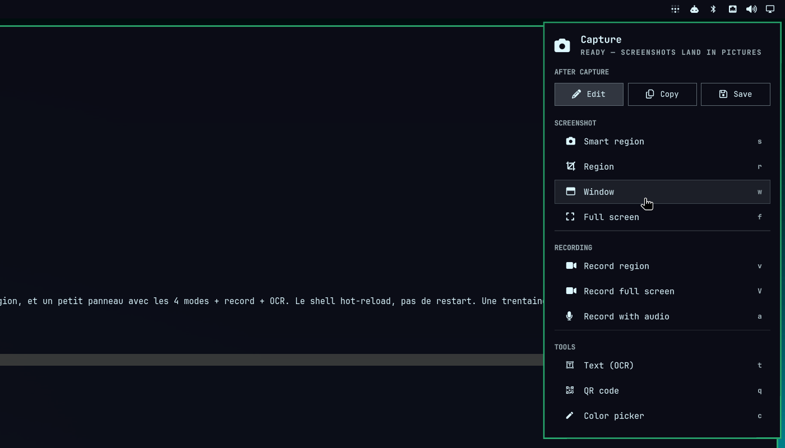
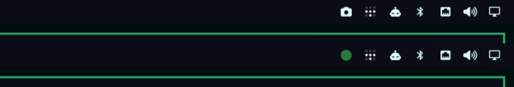

# Screenshot widget for the Omarchy bar

A bar widget for [Omarchy](https://omarchy.org/) that puts every capture flow
Omarchy ships — screenshots, screen recording, OCR, QR decoding, color
picking — one click away. It wraps the stock `omarchy-capture-*` commands,
so nothing new runs on your machine: it is the same code path as the
`PRINT` key and the Omarchy menu, just reachable from the bar.



## Install

```bash
omarchy plugin add https://github.com/tarpediem/omarchy-screenshot-widget.git --enable
```

Pick the bar section when prompted (the default is `right`), or place it
yourself afterwards:

```bash
omarchy bar put tarpediem.screenshot --after omarchy.tray
```

Update later with `omarchy plugin update tarpediem.screenshot`, remove with
`omarchy plugin remove tarpediem.screenshot`.

Requires Omarchy 4.x (the Quickshell-based shell). No extra packages: `grim`,
`slurp`, `gpu-screen-recorder`, `tesseract` and `hyprpicker` are what Omarchy
already uses for its own capture commands.

## Bar icon



- **Left click** opens the capture panel
- **Right click** takes a smart-region screenshot right away — or stops the
  recording while one is running
- **Middle click** takes a region screenshot right away
- While `gpu-screen-recorder` runs, the camera turns into a pulsing record dot

## Panel

| Section | Rows |
|---|---|
| After capture | **Edit** (save + clipboard + editor notification), **Copy** (clipboard only), **Save** (file only) — the second argument of `omarchy-capture-screenshot` |
| Screenshot | Smart region, Region, Window, Full screen, Webcam photo (live mpv viewfinder — `Space` shoots, `Q` cancels; honors the after-capture mode) |
| Recording | Record region, Record full screen, Record with desktop + microphone audio — replaced by **Stop recording** while one runs |
| Tools | Text (OCR), QR code, Color picker |

The "After capture" choice is persisted in `~/.config/omarchy/shell.json` on
the widget's entry as `processing`, and can also be set from the CLI:

```bash
omarchy bar set tarpediem.screenshot processing save   # slurp | copy | save
```

The panel closes itself and waits for its fade-out before launching a
capture, so the popup never ends up in the screenshot.

### Keyboard

| Keys | Action |
|---|---|
| `j` / `k`, arrows | move the cursor |
| `Enter`, `Space` | run the highlighted row |
| `s` `r` `w` `f` | smart / region / window / full-screen screenshot |
| `b` | webcam photo (photobooth preview) |
| `v` `V` `a` | record region / full screen / with audio |
| `x` | stop recording |
| `t` `q` `c` | OCR text / QR code / color picker |
| `1` `2` `3`, `m`, `h` / `l` | after-capture mode |
| `Tab` / `Shift+Tab` | switch to the neighbouring bar panel |
| `Esc` | close |

## IPC

The widget registers the `tarpediem.screenshot` IPC target, handy for
Hyprland keybindings:

```bash
omarchy-shell tarpediem.screenshot toggle              # open/close the panel
omarchy-shell tarpediem.screenshot screenshot region   # smart|region|windows|fullscreen
omarchy-shell tarpediem.screenshot stop                # stop a running recording
```

## Files

```
manifest.json   plugin manifest (kind: bar-widget, settings schema)
Panel.qml       bar button + keyboard panel, built on Omarchy's qs.Ui kit
```

## License

MIT — see [LICENSE](LICENSE).
